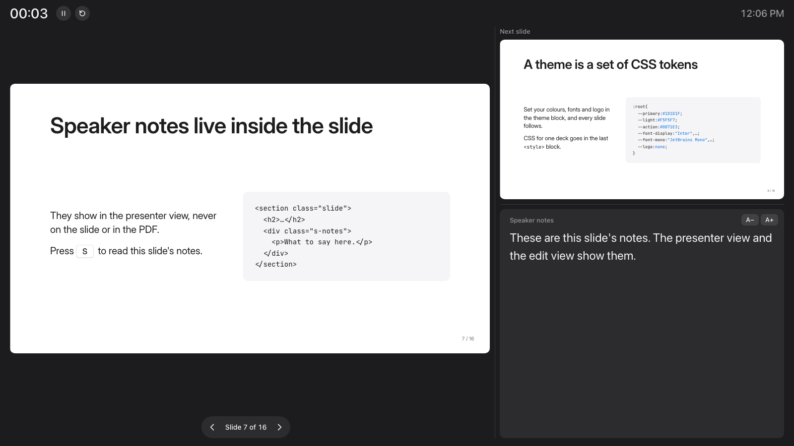
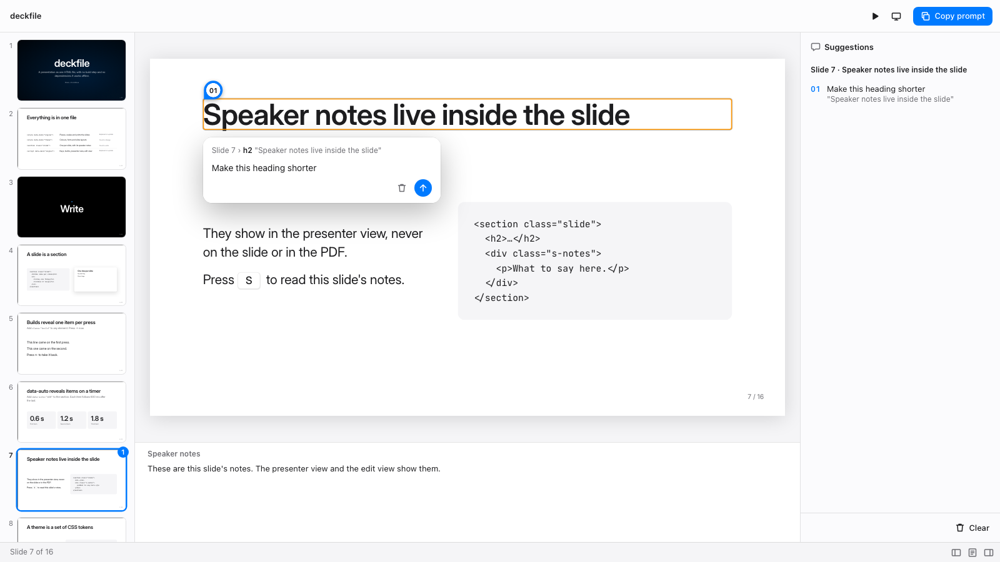

# 

Presentations as one self-contained HTML file. No build step, no bundler, no
dependencies: the slides, the engine and the theme live in a single
`index.html` that opens straight from disk, without a network, and works the
same from any static host. [See the live demo](https://roaldnefs.github.io/deckfile/).

- 1920×1080 slides, scaled to any screen
- builds, one step at a time or timed
- a presenter view in a second window, with speaker notes and a timer
- print to PDF with one page per slide
- an edit view like PowerPoint's: change text and elements, add, duplicate, reorder and delete
  slides, and save the file, or suggest changes and copy them as one prompt for a
  coding agent
- about 1,700 lines of plain JavaScript and 50 of CSS, readable in the file itself

<p>
  
  
</p>

## Quick start

1. Copy [`template.html`](template.html) to `my-talk/index.html`.
2. Open it in a browser. Press `→` to step through it.
3. Replace the example slides with your own, and change the theme tokens to
   your brand.

The template explains deckfile, and shows every slide type and component of the
default theme. They are listed in
[`skills/deck/references/components.md`](skills/deck/references/components.md).
The template's header comment is a short reference to the markup.

## Presenting

1. Set the laptop to extend the display to the projector, not mirror it.
2. Open the deck and press `S`. A second window opens with the presenter view.
   If nothing opens, allow pop-ups for the page.
3. Drag the deck window to the projector and press `F` there for fullscreen.
   Keep the presenter view on the laptop screen.
4. Steer from either window with the arrow keys, Space or a clicker. Both
   windows stay in step.

The presenter view is laid out like PowerPoint's. The current slide is on the
left, with previous and next buttons, the slide count and the builds left on
the slide below it. On the right is what the next press shows (the next build,
or the next slide as it first appears), above the speaker notes, with A− / A+
to resize them. Along the top are the clock and the elapsed timer, which starts
when the deck first moves and has pause and reset buttons. A red "Not
linked" badge shows when the deck window is closed or stops answering; if the
deck window reloads, the two link up again by themselves within a few seconds.
Drag the bars between the panes to resize them, and double-click a bar to reset
it. The layout and the notes size are remembered in that browser.

The deck window, the presenter view and its two slide previews are all the same
file: `?presenter` is the presenter view and `?view` a read-only slide. They
talk with `postMessage`, which also works between pages opened from `file://`.

## Keys

| Key | Action |
|---|---|
| `→` `Space` `PgDn` | next build step, then next slide |
| `←` `PgUp` | undo build step, then previous slide |
| `↓` / `↑` | skip a whole slide forward / back, all builds shown |
| `Home` / `End` | first / last slide |
| `F` | fullscreen |
| `P` | print to PDF, one page per slide, all builds shown |
| `S` | presenter view in a second window |
| `E` | edit view, see [Editing and suggesting](#editing-and-suggesting) |
| `N` / `Esc` | in the edit view: fold the notes pane / drop the selection, or else leave the view |
| `Cmd/Ctrl+↑` / `↓` | in the edit view: move the current slide earlier / later |
| click / tap / swipe | left 30 % of the screen back, the rest forward; swipe left / right on touch |
| pointer near the bottom-left corner | buttons for back, the presenter view, the edit view, the shortcuts and forward |

Add `?print` to the URL to open the print dialog as soon as the deck has
loaded, for a "Print to PDF" link. The current slide is kept in
`sessionStorage`, so a reload during a talk lands on the same slide.

## Writing slides

The engine needs very little markup:

```html
<div id="stage">
  <section class="slide">
    <h2>One idea per slide</h2>
    <ul>
      <li class="build">Revealed on the first →</li>
      <li class="build">and this one on the second</li>
    </ul>
    <div class="s-notes"><p>What to say here.</p></div>
  </section>
</div>
```

| Markup | Meaning |
|---|---|
| `<div id="stage">` | holds the slides, a fixed 1920×1080 canvas |
| `<section class="slide">` | one slide, in document order |
| `class="build"` on any element | revealed one at a time with `→` |
| `data-auto="600"` on a section | its builds reveal by themselves, one every 600 ms, as soon as the slide shows; `→` and `←` take over |
| `<div class="s-notes">` inside a slide | speaker notes, for the presenter and edit views |

The engine sets `.current` on the slide shown and `.on` on each build it
reveals, and adds a `<span class="counter">` with the slide number to every
slide. Style against those classes: `.slide.current .diagram{animation:…}`
starts an animation each time a slide shows, and `.slide:has(#step2.on)`
changes a slide as a build lands. Saving from the edit view leaves all three out
of the file.

Everything else, such as title cards, dividers, dark slides, stat rows, code
panels and windows, comes from the theme. Its components are listed in
[`skills/deck/references/components.md`](skills/deck/references/components.md).

Photographs live beside the deck as ordinary files and are referenced by
relative path. Inline small things such as logos and icons as SVG; don't
base64 large images into the HTML.

## Editing and suggesting

Press `E` for the edit view, laid out like PowerPoint's: slide thumbnails on the
left, the slide with its speaker notes below it, and on the right the unsaved
edits in Edit or the suggestions in Suggest. Every slide shows with all its
builds. The play button in the toolbar or `E` goes back to the slides. The
**Edit** and **Suggest** switch in the toolbar says what a click on the slide
does: Edit changes the deck, Suggest collects suggestions for whoever edits the
file. The view opens in Edit the first time, then in the mode you last used in
this tab. Pressing a suggestion's mark in Edit goes to Suggest.

### Edit

- Double-click text to type in it. `Enter` or `Tab` keeps it, `Esc` takes it back,
  `Shift+Enter` is a new line, and a press elsewhere keeps it. Inline elements such
  as `<code>` stay. Text you empty deletes its element. Pasted text is plain.
- Click an element to select it, then **Select parent**, **Move earlier**, **Move
  later**, **Duplicate** or **Delete** in the toolbar (or the `Delete` key). Moving
  swaps it with its neighbour, as slides lay out by flow, not by position.
- Code panels and drawings are selected and moved whole, and not typed in. Neither
  is a block whose children are not all inline, such as a panel of labels: select
  its text instead.
- Type in the notes pane to change the notes of the slide. Notes you empty are
  removed.
- **New slide** in the toolbar opens a menu with a preview of each layout: Title,
  Content, Two columns and Section. The one you click is added after the current slide, with text to
  type over. The layouts are `<section>`s in the deck's
  `<template data-deck="layouts">`, each named by `data-layout`, so you can change
  them or add your own. Keep them to text: a terminal panel or an image can't be
  filled in from the edit view. With one layout the button adds it at once, and a
  deck without the block gets a plain slide.
- **Duplicate slide** in the toolbar adds a copy after the current slide, with its
  notes and builds. **Delete slide** deletes the current slide, and hovering a
  thumbnail gives × to delete that one; the last slide left can't be deleted.
- Drag a thumbnail to move its slide, or press `Cmd/Ctrl+↑` or `↓` to move the
  current one. A slide's comment in the source moves and goes with it; a copy has
  no comment.
- The side pane lists every edit not saved yet, by slide, with those of deleted
  slides first. Click one to go there and select its element.
  Hover one for × to remove just that edit: later edits stay, on the same elements.
  A later one goes with it only if it can't stand without it, such as text typed in
  a copy whose duplication is removed, text retyped over the text being removed, or
  edits on a slide whose adding or duplication is removed.
  × asks for a second click then.
  **Clear**, clicked twice, removes them all. Removing can't itself be undone.
- **Undo** or `Cmd/Ctrl+Z` takes back one change at a time, on any slide. An edit
  not saved yet leaves the list. Taking back a saved one joins it, as the file then
  differs from the slide.
- **Save** or `Cmd/Ctrl+S` writes the deck: to a file you choose once per visit in
  Chromium, and as a download elsewhere. Choose the deck's own file to replace it.
  It overwrites what is there, so if an agent or editor changed the file since you
  opened it, reload first. The browser asks before you leave with unsaved changes.

### Suggest

- Move the cursor over the slide and the element under it is outlined in orange.
  Click to select it, click the background to pin a spot, or drag to draw a box
  around an area. Type the suggestion in the box that opens and press `Enter`
  (`Shift+Enter` for a new line). A suggestion left empty is dropped.
- To select what surrounds an element, such as the card around a line of text,
  click a level in the top line of that box, or press `↑` and `↓` while the box
  is empty.
- While the box is open, the top bar has **Select parent**, **Select child**,
  **Delete suggestion** and **Save suggestion**.
- Each suggestion records its slide and heading, its place in the 1920×1080
  frame, and the element it is on, with a selector and its text.
- When the deck has changed, a suggestion follows its element to where it is now.
  If that element has changed or no single match exists, the suggestion is
  labelled **Changed**, and the prompt says so. While the deck is open it stays
  with its slide, also when another slide looks the same, and is labelled
  **Changed** while its slide is deleted.
- **Copy prompt**, at the bottom of the suggestions, puts every suggestion on the
  clipboard as one Markdown prompt that names the deck file, ready to paste into
  Claude Code or another coding agent working on the deck.
- Click a suggestion, or its mark, to change it. Hover one for × to delete it,
  or click **Clear** twice to delete them all; **Undo** brings them back for a
  few seconds.
- Each thumbnail shows how many suggestions its slide has. The buttons in the
  status bar fold the thumbnails, notes and side pane away to give the slide
  more room.

A refresh stays in the edit view, in the same mode, but loses unsaved changes.
Suggestions are kept per deck in that browser (`localStorage`). They are not
shared; send the copied prompt instead.

## Theming

A deck has three `<style>` blocks:

```html
<style data-deck="engine">…</style>   <!-- the engine: don't edit -->
<style data-deck="theme">…</style>    <!-- the theme: yours to change -->
<style>/* deck-specific */</style>    <!-- CSS for this deck alone -->
```

The default theme has white slides with large, quiet type and one accent colour,
and black `.dark` slides for emphasis. To
brand it, change the tokens in its `:root`: colours, three font stacks, and
logo slots that take an SVG data URI. Anything bigger, such as square panels
or a different title card, goes in the theme block or the deck-specific block.
The tokens are listed in
[`skills/deck/references/theming.md`](skills/deck/references/theming.md).

Use only fonts whose license permits it, such as SIL Open Font License faces
from Google Fonts, and fall back to generic families (`system-ui`, `serif`,
`monospace`) so the deck still reads well offline. The default theme uses Inter
and JetBrains Mono, the same on every platform when online.

## Updating the engine

The engine lives in a deck between two pairs of tags:
`<style data-deck="engine">` in the head and `<script data-deck="engine">` at
the end of the body. To bring a deck up to the current version:

```sh
npx github:roaldnefs/deckfile update my-talk/index.html
```

This replaces only what is inside the engine tags. The theme, the slides and
your own scripts stay as they are. `update --check` writes nothing and exits 1
when a deck is out of date, for use in CI. From a clone, run
`node bin/deckfile.mjs update …` instead.

An update leaves `<template data-deck="layouts">` alone too. A deck from before it
existed adds plain slides until you copy the block from `template.html`.

If you'd rather not inline the engine, link it. A plain script works from
`file://`:

```html
<link rel="stylesheet" href="deckfile/src/deck.css">
<link rel="stylesheet" href="deckfile/src/theme.css">
…
<script src="deckfile/src/deck.js"></script>
```

Saving from the edit view writes the engine blocks back unchanged, so
`update` keeps working on a saved deck.

## Extending

Don't edit the engine. Put behaviour a deck needs in a small `<script>` of its
own after the engine's, and watch the `.current` class. For example, to play a
video while its slide is shown:

```html
<script>
(() => {
  const video = document.querySelector('.slide video');
  const slide = video.closest('.slide');
  const sync = () => slide.classList.contains('current') ? video.play().catch(() => {}) : video.pause();
  new MutationObserver(sync).observe(slide, { attributes: true, attributeFilter: ['class'] });
})();
</script>
```

## With Claude Code

This repository is also a Claude Code plugin with a `deck` skill. The skill
writes a deck from a brief: an outline first, then the slides, speaker notes
and a self-check.

```
/plugin marketplace add roaldnefs/deckfile
/plugin install deckfile@deckfile
```

Or copy or symlink [`skills/deck`](skills/deck) into `~/.claude/skills/`.

## Browsers and limits

The automated tests run in Chromium. Firefox and Safari are not tested yet.

- Speaker notes and the timer are in the presenter view, which needs a second
  window. Allow pop-ups for the page. A phone or tablet that can't open one gets
  no notes.
- Suggestions stay in the browser that made them. To share them, send the copied
  prompt.
- The browser is the only source a saved file can come from, so the first save
  rewrites some markup the same way the browser reads it: self-closed SVG tags,
  `<tbody>` in tables, entities, `&` in links, empty attributes. Comments and
  indentation stay, and later saves change only what you changed. A number in a
  comment, such as `<!-- 2 · … -->`, is not updated when slides move.
- Saving keeps whatever else is in the page: changes made by a deck's own script,
  or by a browser extension, end up in the file. Undo replaces a slide's elements,
  so such a script loses hold of what it found before.
- A deck saved to another folder loses the photos beside it, as their paths are
  relative. An open presenter window shows the file as it was: reopen it after
  saving. Until then it follows the deck by position, so after adding, moving or
  deleting slides it can show a different slide from the deck window.
- The edit view's side panes have a fixed width. In a small window, fold them away
  with the buttons in its status bar.
- Dragging thumbnails needs a mouse or trackpad: touch screens can't drag them, and
  the keyboard shortcut is the other way to reorder.
- Photos sit beside the file, so a deck with photos travels as a folder.

## Development

```sh
npm install
npx playwright install chromium
npm test
```

`npm test` runs the CLI tests and an end-to-end suite in Chromium against
`template.html`, opened from `file://` with the network blocked. Set `DECK` to
run the suite against another deck: `DECK=path/to/index.html npx playwright test`.

The engine sources are `src/deck.js`, `src/deck.css` and the default theme
`src/theme.css`. After changing them, run
`node bin/deckfile.mjs update template.html skills/deck/assets/template.html`;
the tests fail while a copy is out of date.

## License

[MIT](LICENSE)
