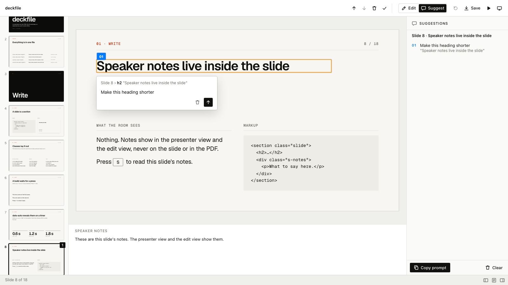
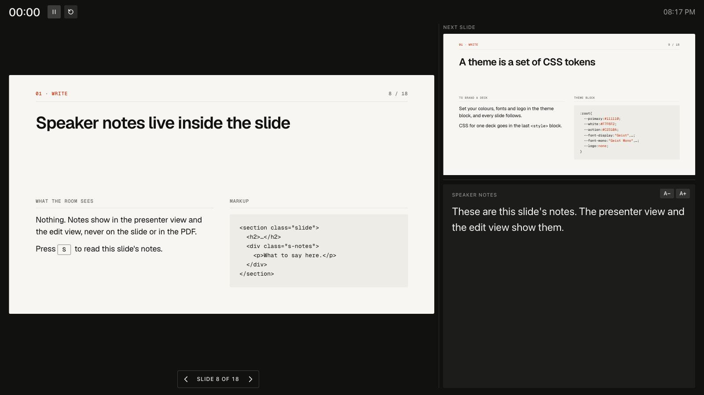

<p align="center">
  
</p>

<h1 align="center">deckfile</h1>

<p align="center">
  <b>Presentations as one self-contained HTML file; no build step, no bundler, no dependencies.</b><br>
  The slides, the engine and the theme live in a single <code>index.html</code> that opens straight from disk,<br>
  without a network, and works the same from any static host.
</p>

<p align="center">
  
  
  
  <a href="LICENSE"></a>
  <a href="https://github.com/roaldnefs/deckfile/actions/workflows/test.yml"></a>
</p>

<p align="center">
  <a href="https://roaldnefs.github.io/deckfile/"><b>See the live demo</b></a> ·
  <a href="template.html">Template</a> ·
  <a href="skills/deck">Claude Code skill</a>
</p>

<br>

<p align="center">
  
  <br>
  <sub>The edit view: change the deck in place, or collect suggestions and copy them as one prompt.</sub>
</p>

<p align="center">
  <a href="#quick-start">Quick start</a> ·
  <a href="#presenting">Presenting</a> ·
  <a href="#keys">Keys</a> ·
  <a href="#writing-slides">Writing slides</a> ·
  <a href="#editing-and-suggesting">Editing</a> ·
  <a href="#theming">Theming</a> ·
  <a href="#updating-the-engine">Updating</a> ·
  <a href="#with-claude-code">Claude Code</a> ·
  <a href="#limits">Limits</a>
</p>

<br>

<table>
  <tr>
    <td width="25%" valign="top">
      <h3>One file</h3>
      1920×1080 slides, scaled to any screen, with builds one step at a time or timed. About 1,700 lines of plain JavaScript and 50 of CSS, readable in the file itself.
    </td>
    <td width="25%" valign="top">
      <h3>Present</h3>
      A presenter view in a second window, with speaker notes, the next slide and a timer. Print to PDF with one page per slide.
    </td>
    <td width="25%" valign="top">
      <h3>Edit in place</h3>
      Change text, move elements, add and reorder slides in the browser, then save the file. No editor, no build.
    </td>
    <td width="25%" valign="top">
      <h3>Agent-ready</h3>
      Collect suggestions on the slides and copy them as one prompt for a coding agent, or have the Claude Code skill write the deck from a brief.
    </td>
  </tr>
</table>

<br>

## Quick start

1. Copy [`template.html`](template.html) to `my-talk/index.html`.
2. Open it in a browser. Press `→` to step through it.
3. Replace the example slides with your own, and change the theme tokens to
   your brand.

The template explains deckfile, and shows every slide type and component of the
default theme. They are listed in
[`skills/deck/references/components.md`](skills/deck/references/components.md).
The template's header comment is a short reference to the markup.

## Presenting

1. Set the laptop to extend the display to the projector, not mirror it.
2. Open the deck and press `S`. A second window opens with the presenter view.
   If nothing opens, allow pop-ups for the page.
3. Drag the deck window to the projector and press `F` there for fullscreen.
   Keep the presenter view on the laptop screen.
4. Steer from either window with the arrow keys, Space or a clicker. Both
   windows stay in step.

<p align="center">
  
  <br>
  <sub>The presenter view: the current slide, what comes next, the notes and the timer.</sub>
</p>

The presenter view shows the current slide, what the next press brings, the
speaker notes, a clock and a timer that starts when the deck first moves. Drag
the bars between the panes to resize them. A red "Not linked" badge means the
deck window was closed or stopped answering; after a reload of the deck the two
link up again by themselves.

The deck, the presenter view and its slide previews are all the same file
(`?presenter` and `?view`). They talk with `postMessage`, which also works
between pages opened from `file://`.

## Keys

| Key | Action |
|---|---|
| `→` `Space` `PgDn` | next build step, then next slide |
| `←` `PgUp` | undo build step, then previous slide |
| `↓` / `↑` | skip a whole slide forward / back, all builds shown |
| `Home` / `End` | first / last slide |
| `F` | fullscreen |
| `P` | print to PDF, one page per slide, all builds shown |
| `S` | presenter view in a second window |
| `E` | edit view, see [Editing and suggesting](#editing-and-suggesting) |
| `N` / `Esc` | in the edit view: fold the notes pane / drop the selection, or else leave the view |
| `Cmd/Ctrl+↑` / `↓` | in the edit view: move the current slide earlier / later |
| click / tap / swipe | left 30 % of the screen back, the rest forward; swipe left / right on touch |
| pointer near the bottom-left corner | buttons for back, the presenter view, the edit view, the shortcuts and forward |

Add `?print` to the URL to open the print dialog as soon as the deck has
loaded, for a "Print to PDF" link. The current slide is kept in
`sessionStorage`, so a reload during a talk lands on the same slide.

## Writing slides

The engine needs very little markup:

```html
<div id="stage">
  <section class="slide">
    <h2>One idea per slide</h2>
    <ul>
      <li class="build">Revealed on the first →</li>
      <li class="build">and this one on the second</li>
    </ul>
    <div class="s-notes"><p>What to say here.</p></div>
  </section>
</div>
```

| Markup | Meaning |
|---|---|
| `<div id="stage">` | holds the slides, a fixed 1920×1080 canvas |
| `<section class="slide">` | one slide, in document order |
| `class="build"` on any element | revealed one at a time with `→` |
| `data-auto="600"` on a section | its builds reveal by themselves, one every 600 ms, as soon as the slide shows; `→` and `←` take over |
| `<div class="s-notes">` inside a slide | speaker notes, for the presenter and edit views |

The engine sets `.current` on the slide shown and `.on` on each build it
reveals, and adds a `<span class="counter">` with the slide number to every
slide. Style against those classes: `.slide.current .diagram{animation:…}`
starts an animation each time a slide shows, and `.slide:has(#step2.on)`
changes a slide as a build lands. Saving from the edit view leaves all three out
of the file.

Everything else, such as title cards, dividers, dark slides, stat rows, code
panels and windows, comes from the theme. Its components are listed in
[`skills/deck/references/components.md`](skills/deck/references/components.md).

Photographs live beside the deck as ordinary files and are referenced by
relative path. Inline small things such as logos and icons as SVG; don't
base64 large images into the HTML.

## Editing and suggesting

Press `E` for the edit view: thumbnails on the left, the slide with its speaker
notes in the middle, and the unsaved edits or the suggestions on the right. The
**Edit** / **Suggest** switch in the toolbar sets what a click on the slide does.

**Edit** changes the deck:

- Double-click text to type in it. `Enter` keeps it, `Esc` takes it back.
- Click an element to select it, then move, duplicate or delete it from the
  toolbar.
- Type in the notes pane to change the speaker notes.
- Add, duplicate and delete slides from the toolbar, and drag a thumbnail to
  reorder. New slides come from the layouts in the deck's
  `<template data-deck="layouts">`, which you can change or add to.
- **Undo** or `Cmd/Ctrl+Z` takes back one change. × on a row in the list of
  unsaved edits removes just that edit.
- **Save** or `Cmd/Ctrl+S` writes the deck: to a file you choose in Chromium,
  as a download elsewhere. It overwrites what is there, so reload first if an
  agent or editor changed the file since you opened it.

**Suggest** leaves the deck alone and collects notes for whoever edits the file:

- Click an element, click the background to pin a spot, or drag a box around an
  area, then type the suggestion.
- **Copy prompt** puts every suggestion on the clipboard as one Markdown prompt,
  each with its slide, its position and a selector for its element, ready to
  paste into Claude Code or another coding agent.
- Suggestions are kept per deck in the browser's `localStorage`. One whose
  element has changed since is labelled **Changed**.

## Theming

A deck has three `<style>` blocks:

```html
<style data-deck="engine">…</style>   <!-- the engine: don't edit -->
<style data-deck="theme">…</style>    <!-- the theme: yours to change -->
<style>/* deck-specific */</style>    <!-- CSS for this deck alone -->
```

The default theme has white slides with large, quiet type and one accent colour,
and black `.dark` slides for emphasis. To
brand it, change the tokens in its `:root`: colours, three font stacks, and
logo slots that take an SVG data URI. Anything bigger, such as square panels
or a different title card, goes in the theme block or the deck-specific block.
The tokens are listed in
[`skills/deck/references/theming.md`](skills/deck/references/theming.md).

Use only fonts whose license permits it, such as SIL Open Font License faces
from Google Fonts, and fall back to generic families (`system-ui`, `serif`,
`monospace`) so the deck still reads well offline. The default theme uses Inter
and JetBrains Mono, the same on every platform when online.

## Updating the engine

The engine lives in a deck between two pairs of tags:
`<style data-deck="engine">` in the head and `<script data-deck="engine">` at
the end of the body. To bring a deck up to the current version:

```sh
npx github:roaldnefs/deckfile update my-talk/index.html
```

This replaces only what is inside the engine tags. The theme, the slides and
your own scripts stay as they are. `update --check` writes nothing and exits 1
when a deck is out of date, for use in CI. From a clone, run
`node bin/deckfile.mjs update …` instead.

An update leaves `<template data-deck="layouts">` alone too. A deck from before it
existed adds plain slides until you copy the block from `template.html`.

If you'd rather not inline the engine, link it. A plain script works from
`file://`:

```html
<link rel="stylesheet" href="deckfile/src/deck.css">
<link rel="stylesheet" href="deckfile/src/theme.css">
…
<script src="deckfile/src/deck.js"></script>
```

Saving from the edit view writes the engine blocks back unchanged, so
`update` keeps working on a saved deck.

## Extending

Don't edit the engine. Put behaviour a deck needs in a small `<script>` of its
own after the engine's, and watch the `.current` class. For example, to play a
video while its slide is shown:

```html
<script>
(() => {
  const video = document.querySelector('.slide video');
  const slide = video.closest('.slide');
  const sync = () => slide.classList.contains('current') ? video.play().catch(() => {}) : video.pause();
  new MutationObserver(sync).observe(slide, { attributes: true, attributeFilter: ['class'] });
})();
</script>
```

## With Claude Code

This repository is also a Claude Code plugin with a `deck` skill. The skill
writes a deck from a brief: an outline first, then the slides, speaker notes
and a self-check.

```
/plugin marketplace add roaldnefs/deckfile
/plugin install deckfile@deckfile
```

Or copy or symlink [`skills/deck`](skills/deck) into `~/.claude/skills/`.

## Limits

- The tests run in Chromium. Firefox and Safari are not tested yet.
- Speaker notes and the timer are in the presenter view, which needs a second
  window: allow pop-ups for the page.
- The first save from the edit view rewrites some markup the way the browser
  read it: self-closed SVG tags, `<tbody>` in tables, entities. Comments and
  indentation stay, and later saves change only what you changed.
- Photos sit beside the file, so a deck with photos travels as a folder.

## Development

```sh
npm install
npx playwright install chromium
npm test
```

`npm test` runs the CLI tests and an end-to-end suite in Chromium against
`template.html`, opened from `file://` with the network blocked. Set `DECK` to
run the suite against another deck: `DECK=path/to/index.html npx playwright test`.

The engine sources are `src/deck.js`, `src/deck.css` and the default theme
`src/theme.css`. After changing them, run
`node bin/deckfile.mjs update template.html skills/deck/assets/template.html`;
the tests fail while a copy is out of date.

## License

[MIT](LICENSE)
